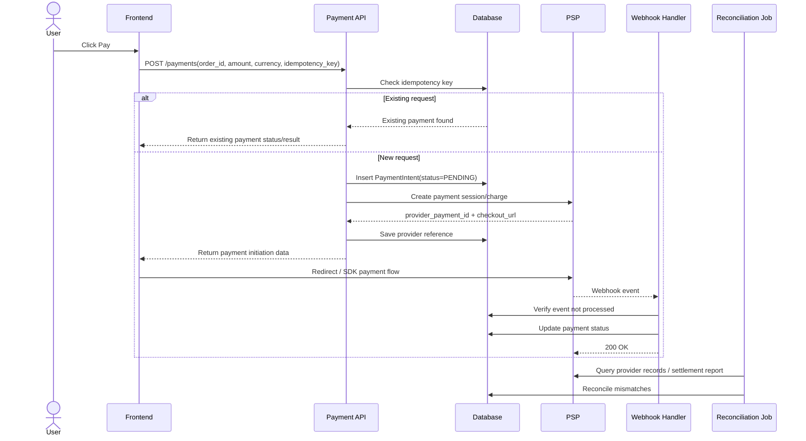
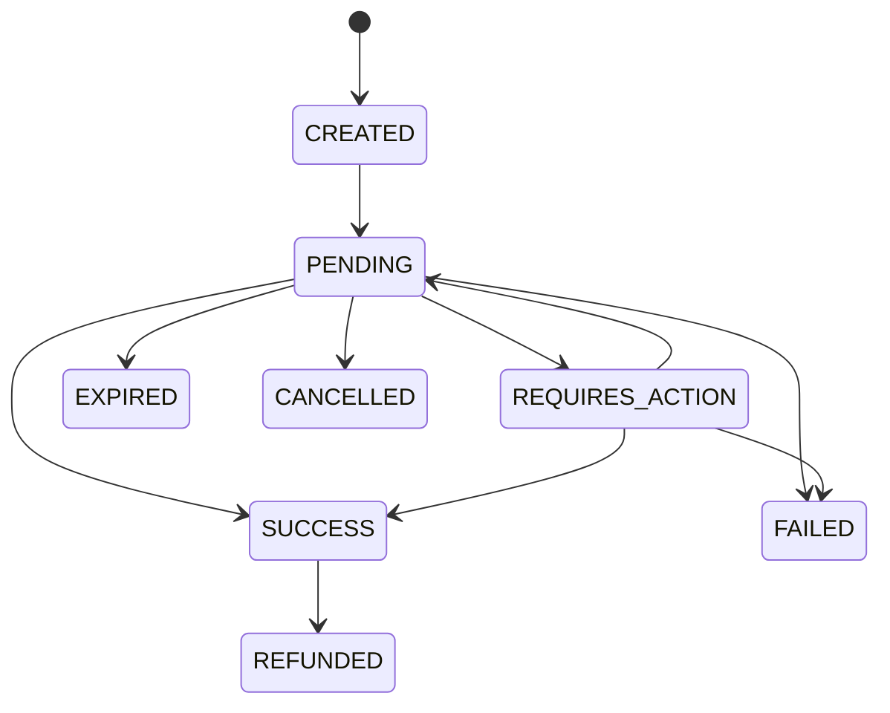
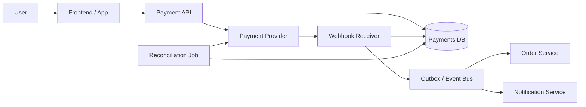

# Payment System Agent Guide for Codex

## Goal

Build and explain a production-ready payment flow that is good enough for both:

- **System design / backend interviews**
- **Real project implementation**

The solution should prioritize **correctness over convenience**:

- Never double-charge a user
- Never lose final payment state
- Never trust client redirect as final truth
- Always support retries safely
- Always support reconciliation with the payment provider

---

## Operating context

Assume the system integrates with a PSP such as Stripe, SePay, Adyen, or similar.
User initiates payment from frontend.
Backend creates and owns payment state.
Provider confirms result asynchronously through webhook.

---

## Core principles

1. **Idempotency first**  
   Any retried request must be safe. Same logical payment request must not create multiple charges.

2. **State machine driven**  
   Payment records must move only through valid transitions.

3. **Webhook is source of truth**  
   Client redirect is for UX only. Final confirmation should come from webhook or reconciliation.

4. **Append-only history**  
   Never delete failed or successful payment attempts. Keep audit trail.

5. **Reconciliation is mandatory**  
   If webhook is delayed, duplicated, or lost, the system must recover by querying provider data or reading settlement reports.

---

## What to produce

When asked to design or implement the payment flow, produce these outputs in order:

1. Requirements
2. High-level architecture
3. Core entities / DB schema
4. API contract
5. Sequence diagram
6. State machine
7. Failure handling
8. Reconciliation design
9. Security notes
10. Interview summary script

---

## Step 1: Clarify scope

Before designing, clarify these questions:

- Is this one-time payment or subscription?
- Is payment capture immediate, or authorize first then capture later?
- Do we need refund support?
- Do we support one provider or multiple providers?
- What payment methods are in scope: card, bank transfer, e-wallet?
- Is partial payment needed?
- Is a single order allowed to have multiple payment attempts?
- What should happen if webhook is delayed for several minutes?

If no answer is given, assume:

- One-time payment
- Single order may have multiple attempts
- Immediate capture
- Webhook-based final confirmation
- Refund support later, not in MVP

---

## Step 2: Functional requirements

Always include at least these requirements:

- Create payment for an order
- Prevent duplicate charge on retry or user spam click
- Return current payment status
- Process provider webhook safely
- Support multiple attempts for one order
- Mark payment success or failure correctly
- Keep audit log of important events
- Reconcile pending or mismatched payments with provider

Optional advanced requirements:

- Refund / partial refund
- Cancel before capture
- Multi-provider routing
- Risk/fraud screening
- Ledger service

---

## Step 3: Non-functional requirements

Always mention:

- Correctness
- Idempotency
- High availability
- Observability
- Auditability
- Security
- Recoverability after partial failures
- Consistency of payment state

If interview context is system design, emphasize:

- No double charge
- At-least-once webhook delivery + idempotent processing
- Eventually consistent reconciliation

---

## Step 4: Core domain model

Use these entities by default:

### 1. Order

Business object representing what user is paying for.

Suggested fields:

- `order_id`
- `user_id`
- `amount`
- `currency`
- `order_status`

### 2. PaymentIntent

Logical payment object owned by internal system.

Suggested fields:

- `payment_intent_id`
- `order_id`
- `amount`
- `currency`
- `status`
- `idempotency_key`
- `provider`
- `provider_payment_id`
- `created_at`
- `updated_at`

### 3. PaymentAttempt

Optional but recommended if one order can be retried multiple times.

Suggested fields:

- `payment_attempt_id`
- `payment_intent_id`
- `attempt_no`
- `status`
- `provider_payment_id`
- `failure_reason`

### 4. WebhookEvent

For deduplicating provider events.

Suggested fields:

- `provider_event_id`
- `provider`
- `event_type`
- `payload_hash`
- `processed_at`
- `status`

### 5. PaymentEvent / AuditLog

Append-only history of internal transitions.

Suggested fields:

- `event_id`
- `payment_intent_id`
- `event_name`
- `from_status`
- `to_status`
- `metadata`
- `created_at`

### 6. ReconciliationRecord

Tracks mismatch investigation.

Suggested fields:

- `reconcile_id`
- `payment_intent_id`
- `provider_payment_id`
- `internal_status`
- `provider_status`
- `result`
- `checked_at`

---

## Step 5: Status model

Use a controlled state machine.

### Simple version

- `CREATED`
- `PENDING`
- `SUCCESS`
- `FAILED`
- `CANCELLED`
- `REFUNDED`

### More realistic card/PSP version

- `CREATED`
- `PENDING`
- `REQUIRES_ACTION`
- `AUTHORIZED`
- `CAPTURED`
- `SETTLED`
- `FAILED`
- `EXPIRED`
- `CANCELLED`
- `REFUNDED`

Rules:

- Never transition backward without a defined compensation flow
- Terminal states should reject invalid transitions
- Timeout does not automatically mean `FAILED`
- `PENDING` may need reconciliation

---

## Step 6: Standard flow from A to Z

Use this as the canonical payment flow.

1. User clicks **Pay** on frontend.
2. Frontend calls `POST /payments` with `order_id`, `amount`, `currency`, and `idempotency_key`.
3. Backend checks whether `(merchant_id, idempotency_key)` already exists.
4. If key exists, return the existing payment result or current status.
5. If key does not exist, create `PaymentIntent` with status `PENDING`.
6. Backend calls PSP to create payment session / charge / checkout session.
7. PSP returns `provider_payment_id`, checkout URL, or client secret.
8. Backend stores provider reference and returns payment initiation data to frontend.
9. Frontend redirects user to PSP or continues SDK flow.
10. User completes payment on PSP side.
11. PSP sends webhook to backend.
12. Backend verifies webhook signature.
13. Backend checks `provider_event_id` for deduplication.
14. If webhook already processed, return success immediately.
15. If webhook is new, validate event and map provider status to internal status.
16. Backend performs valid state transition only.
17. Backend writes audit/payment event.
18. Backend emits side effects safely, ideally through outbox/event queue.
19. Order service is updated after payment confirmation.
20. Reconciliation job later verifies internal records against provider records.

---

## Step 7: API contract template

### Create payment

`POST /payments`

Request:

```json
{
  "order_id": "ord_1001",
  "amount": 100000,
  "currency": "VND",
  "idempotency_key": "idem_ord_1001_v1"
}
```

Response:

```json
{
  "payment_intent_id": "pi_001",
  "status": "PENDING",
  "provider": "stripe",
  "provider_payment_id": "pp_abc123",
  "checkout_url": "https://provider.example/checkout/..."
}
```

### Query payment status

`GET /payments/{payment_intent_id}`

### Webhook endpoint

`POST /webhooks/payments/{provider}`

Webhook handler responsibilities:

- verify signature
- dedupe by provider event ID
- validate event schema
- apply valid state transition
- persist audit event
- return `200 OK` fast

---

## Step 8: Sequence diagram template

Use this exact diagram structure unless the user asks for a different format.



---

## Step 9: State machine template

Use this for diagrams and explanations.



Notes:

- `SUCCESS` and `FAILED` are terminal in simple flows
- some providers use intermediate states before final settlement
- map provider-specific states into a smaller internal model

---

## Step 10: Architecture diagram template

Use this when a high-level view is requested.



---

## Step 11: Failure handling playbook

Always explain these cases.

### 1. Duplicate request

Problem: user double-clicks or network retry resends request.
Solution:

- require idempotency key
- unique constraint in DB
- return previous result for same key

### 2. Provider timeout

Problem: backend does not know whether PSP processed request.
Solution:

- keep payment in `PENDING`
- retry safely with same idempotency key if provider supports it
- query provider by reference later

### 3. Duplicate webhook

Problem: providers often retry webhook delivery.
Solution:

- dedupe by `provider_event_id`
- store event before side effects
- processing must be idempotent

### 4. Out-of-order webhook

Problem: failure or success event arrives after terminal state already set.
Solution:

- enforce valid transitions only
- log and reject invalid transition
- rely on reconciliation if ambiguity remains

### 5. Partial failure after payment success

Problem: payment updated but order service not updated.
Solution:

- use outbox pattern / async worker
- keep payment confirmation and downstream effects decoupled but reliable

### 6. Missing webhook

Problem: PSP completed payment but webhook never arrived.
Solution:

- periodic reconciliation job
- manual ops tooling for investigation

---

## Step 12: Reconciliation design

Reconciliation is not optional.

Minimum reconciliation strategy:

- periodic job every N minutes for recent `PENDING` payments
- daily batch against provider settlement/export data
- compare by provider reference, amount, currency, and final status
- mark mismatch for manual review or automated repair

Typical outcomes:

- `MATCHED`
- `MISSING_INTERNAL`
- `MISSING_PROVIDER`
- `AMOUNT_MISMATCH`
- `STATUS_MISMATCH`

---

## Step 13: Security checklist

Always include these notes:

- Verify webhook signatures
- Use HTTPS only
- Avoid storing raw card details
- Prefer hosted checkout / tokenization to reduce PCI scope
- Encrypt secrets and provider credentials
- Mask sensitive logs
- Audit all status transitions
- Rate-limit public payment endpoints

---

## Step 14: Implementation guidance for a real project

For MVP, implement these first:

1. `payments` table
2. `webhook_events` table with unique constraint
3. `POST /payments`
4. `GET /payments/{id}`
5. webhook receiver
6. idempotency key check
7. basic reconciliation cron job
8. payment state machine in code
9. audit log table

If time permits, add:

- outbox table
- queue worker
- refund support
- provider abstraction layer
- monitoring dashboard

---

## Step 15: Interview answer template

Use this 90-second script:

> I would design the payment flow correctness-first. The user initiates payment from the frontend, but the backend owns the payment state. Each create-payment request must carry an idempotency key so retries or double-clicks do not create multiple charges. The backend creates a payment record in `PENDING`, calls the PSP, stores the provider reference, and returns checkout data. Final payment confirmation should come from webhook, not from client redirect. Webhooks must be deduplicated by provider event ID and processed through a strict payment state machine. If timeout or webhook loss occurs, the system keeps the payment in `PENDING` and resolves truth through reconciliation with the provider. This gives safe retries, auditability, and reliable recovery from partial failures.

---

## Step 16: Coding rules for Codex

When implementing, follow these rules strictly:

- Do not trust frontend redirect as payment success
- Do not update payment status without checking valid transition
- Do not create a new charge when same idempotency key is reused
- Do not delete failed payment attempts
- Do not perform side effects before persisting payment state
- Return `200 OK` quickly from webhook once safely persisted
- Separate provider-specific mapping from internal domain logic
- Keep internal statuses small and provider-agnostic

---

## Step 17: Expected artifacts for delivery

When asked to generate deliverables, provide:

- `agent.md` guidance
- `sequence.mmd` or Mermaid block
- `state-machine.mmd` or Mermaid block
- sample DB schema
- sample API contract
- interview cheat sheet

---

## Step 18: Common mistakes to avoid

- Using `order_id` alone as dedupe key for all attempts
- Treating redirect success page as proof of payment
- Missing unique constraint on idempotency key
- Updating terminal states without transition guard
- Ignoring duplicate webhooks
- Not storing provider references
- No reconciliation job
- Deleting failed records and losing auditability
- Mixing provider-specific statuses directly into business logic everywhere

---

## Step 19: Good final answer style

When explaining to humans, structure the answer like this:

1. Scope
2. Requirements
3. Architecture
4. Payment flow
5. State machine
6. Failure handling
7. Reconciliation
8. Security
9. Interview summary

Keep the wording practical, not academic.
Use short examples with `order_id`, `payment_intent_id`, and `idempotency_key`.

---

## Step 20: Example summary

Example:

- `order_id = ord_1001`
- first request creates `payment_intent_id = pi_001`
- user double-clicks pay with same `idempotency_key`
- backend returns the existing `pi_001` instead of creating `pi_002`
- PSP later sends webhook `evt_789`
- webhook is processed once and recorded
- if webhook is lost, reconciliation checks provider status for `provider_payment_id`

This is the standard design baseline unless project constraints say otherwise.
